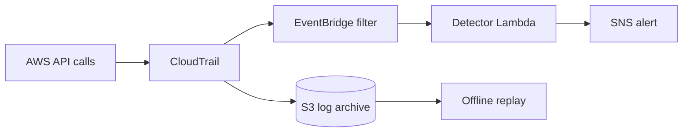

# cloud-detection-lab

AWS detections written as tested code. CloudTrail events flow through EventBridge
to a Lambda that runs eight rules and publishes alerts, with a guarded script that
triggers those rules using real API calls in your own account.

**Status:** code complete, not yet deployed. CI lints the rules, runs every test
and validates the Terraform. There are no results from a live account here yet,
and none will be claimed until a run produces them.

## What it detects

| Rule | Severity | ATT&CK | Fires on |
|---|---|---|---|
| `root-console-login` | critical | T1078.004 | Root user signs in to the console |
| `audit-logging-tampered` | critical | T1562.008 | Trail stopped, changed or deleted, including denied attempts |
| `threat-detection-disabled` | critical | T1562.001 | GuardDuty detector deleted or disabled |
| `access-key-for-another-user` | high | T1098.001 | Access key created for a different IAM user |
| `admin-policy-attached` | high | T1098.003 | AdministratorAccess attached to a user, role or group |
| `bucket-public-access-block-weakened` | high | T1562.007 | S3 public access block removed or weakened |
| `ingress-opened-to-world` | high | T1562.007 | SSH or RDP opened to the internet |
| `console-login-without-mfa` | medium | T1078.004 | IAM user signs in without MFA |
| `denied-call-burst` | medium | T1526 | 20 access denials in 5 minutes from one principal (replay only) |

A test fails if a rule lacks either an attack case or a benign case. All test
events are synthetic.

## How it works



## Run it

No AWS account is needed for the tests.

```bash
pip install pytest ruff
pytest
ruff check .
```

To deploy to a lab account, then trigger the rules:

```bash
cd terraform
terraform init
terraform apply -var alert_email=you@example.com
cd ..
python simulate/run.py --account-id <account> --trail detection-lab --execute
```

Without `--execute`, the simulation only prints its plan. It refuses to run if
your credentials belong to any account but the one you name, and it removes what
it created even if a step fails. To replay stored logs, run this with `src` on
`PYTHONPATH`:

```bash
python -m detections.replay <path-to-cloudtrail-logs>
```

Tear the lab down with `terraform destroy`. Use a dedicated account, because the
simulation stops the trail for a moment and creates an administrator user.

## Design decisions

1. **The filter is generated from the rules.** Each rule names the API calls it
   reads, `event_names.json` is exported from them, and a test fails if the
   committed file drifts. A new rule cannot silently receive no events.
2. **Stateless in Lambda, stateful offline.** Single-event rules run in real time
   with least-privilege access. The burst rule needs state across events, so it
   runs in replay rather than adding a database to a small lab.
3. **Denied tampering still alerts.** Most rules ignore failed calls to stay
   quiet, but a blocked attempt to stop logging is a signal that someone tried.

## Limitations

- Not deployed yet, so false positive rates against real activity are unknown.
- The EventBridge rule covers `us-east-1` only. IAM and console sign-in events
  reach it there, but regional API calls elsewhere are seen only by replay, from
  the multi-region trail.
- Delivery to Lambda can lag CloudTrail by minutes. This is detection, not
  prevention, and there is no automatic response.
- A failed Lambda run has no dead-letter queue. The events remain in S3 for replay.

## More

[docs/runbook.md](docs/runbook.md) has the triage steps for each alert.
